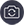
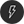
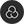
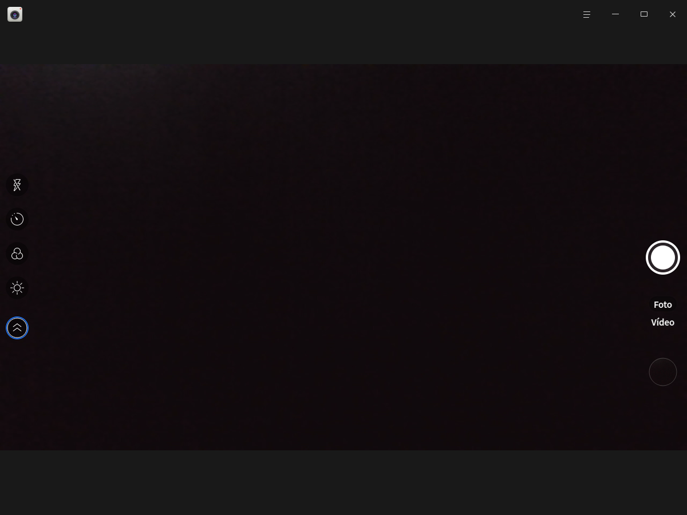
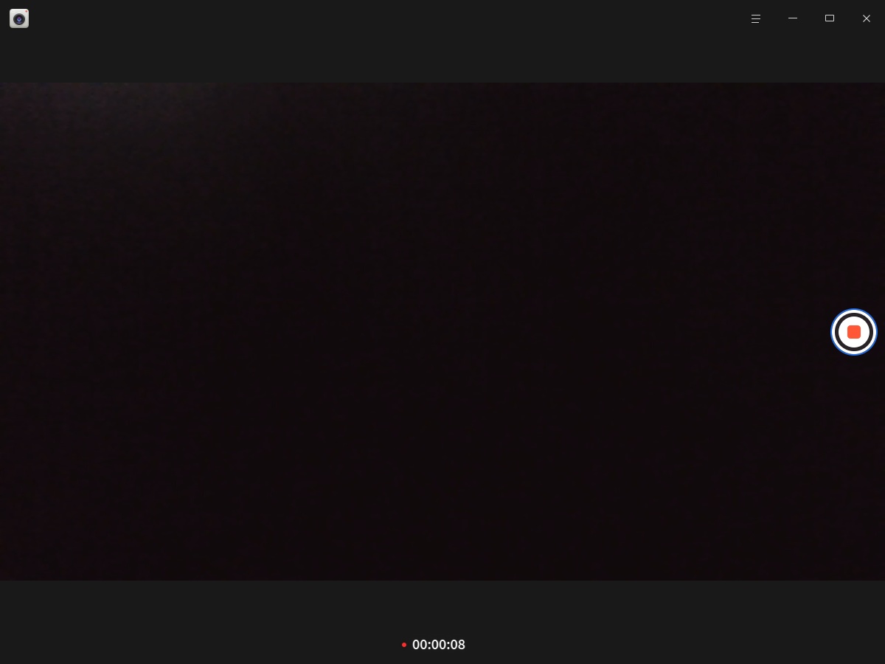
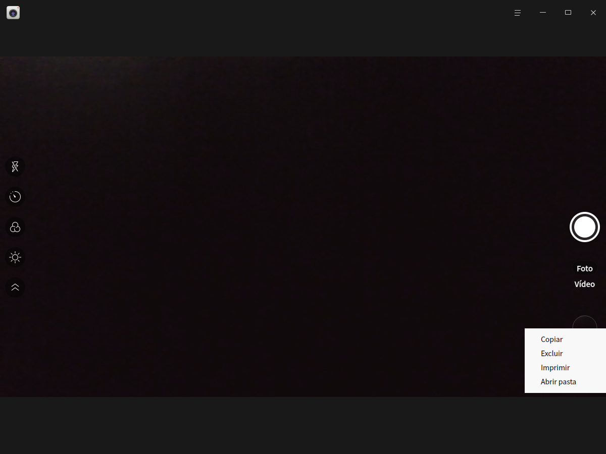

# Câmera|deepin-camera|

## Visão geral

A Câmera é um aplicativo de webcam simples e fácil de usar, que permite tirar fotos, gravar vídeos e alternar entre várias câmeras.

## Primeiros passos

Você pode iniciar a Câmera, fechá-la ou criar um atalho das seguintes formas.

### Iniciar a Câmera

1. Clique no ícone do iniciador na barra de tarefas  para abrir a interface do iniciador.
2. Role a roda do mouse para cima ou para baixo ou use a busca para localizar o ícone da Câmera  e clique nele para iniciar o aplicativo.
3. Clique com o botão direito em  para:
   - Clicar em **Enviar para a área de trabalho** e criar um atalho na área de trabalho.
   - Clicar em **Enviar para a barra de tarefas** e fixar o aplicativo na barra de tarefas.
   - Clicar em **Iniciar automaticamente ao ligar** e adicionar o aplicativo aos itens de inicialização, para que ele seja executado automaticamente ao ligar o computador.

### Fechar a Câmera

- Na interface da Câmera, clique em  para sair do aplicativo.
- Na barra de tarefas, clique com o botão direito em  e selecione **Fechar tudo** para sair do aplicativo.
- Na interface da Câmera, clique em  e selecione **Sair** para sair do aplicativo.

## Ícones

<table class="block1">
    <tbody>
        <tr>
            <td></td>
            <td>Tirar foto</td>
            <td></td>
            <td>Vídeo</td>
            <td></td>
            <td>Alternar câmera</td>
        </tr>
        <tr>
            <td></td>
            <td>Expandir a barra de ferramentas</td>
            <td></td>
            <td>Recolher a barra de ferramentas</td>
            <td></td>
            <td>Captura com atraso</td>
       </tr>   
       <tr>
            <td></td>
            <td>Ativar o flash</td>
            <td></td>
            <td>Definir filtro</td>
            <td></td>
            <td>Ajustar a exposição</td>
        </tr>
    </tbody>
</table>

>  Observação: o botão de alternar câmera  só aparece na interface quando há várias câmeras conectadas.

## Operações

Para usar a Câmera, o computador precisa ter uma webcam integrada ou uma câmera externa conectada. Depois de abrir a Câmera, clique em **Tirar foto** ou **Vídeo** para alternar o modo; em **Configurações > Configurações de foto** você também pode ativar o espelhamento da câmera, que inverte a imagem na horizontal.

>  Observação: tecnologias de decodificação diferentes oferecem conjuntos de recursos diferentes; considere o que aparece na interface real.

### Tirar foto

Ao abrir a Câmera, o modo de foto é o padrão. Clique no botão de captura  e o arquivo de imagem gerado é exibido na interface.

### Gravar vídeo 

Na interface principal da Câmera, clique em **Vídeo** para entrar no modo de vídeo. Clique no botão de gravação  para gravar e, ao terminar, clique no botão de encerrar a gravação . O arquivo de vídeo é exibido na interface e também é salvo no caminho padrão.

### Gerenciar fotos e vídeos

Na interface principal da Câmera, clique com o botão direito em um arquivo de foto ou vídeo para copiar, excluir, imprimir ou abrir a pasta que o contém.

- Copiar: copia a foto ou o vídeo selecionado para outro caminho.
- Excluir: exclui a foto ou o vídeo selecionado.
- Imprimir: imprime a foto selecionada. Ao clicar em **Imprimir**, a interface de visualização de impressão é aberta, onde você pode ajustar as opções antes de imprimir.

   > Observação: apenas arquivos de imagem podem ser impressos; o botão de imprimir não aparece para arquivos de vídeo.

- Abrir pasta: abre a pasta em que a foto ou o vídeo está armazenado.

## Menu principal

No menu principal você pode configurar a Câmera, alternar o tema da janela e consultar o manual de ajuda.

### Configurações

1. Na interface da Câmera, clique em .
2. Clique em **Configurações** para acessar as configurações básicas, as configurações de foto e as configurações de saída.

   - Configurações básicas: define o caminho padrão de armazenamento de fotos e vídeos e escolhe o estilo da grade de composição.
   - Configurações de foto: define o efeito sonoro, a quantidade de fotos em sequência e o tempo de atraso da captura; ativa ou desativa o espelhamento da câmera e o flash.
   - Configurações de saída: mostra o formato de saída das imagens, define o formato de saída dos vídeos e a resolução de saída de fotos e vídeos.

### Tema

O tema da janela inclui tema claro, tema escuro e tema do sistema.

1. Na interface da Câmera, clique em .
2. Clique em **Tema** e escolha uma cor de tema.

### Ajuda

1. Na interface da Câmera, clique em .
2. Clique em **Ajuda** para consultar o manual e conhecer melhor o aplicativo.

### Sobre

1. Na interface da Câmera, clique em .
2. Clique em **Sobre** para ver a versão e a descrição da Câmera.

### Sair

1. Na interface da Câmera, clique em .
2. Clique em **Sair**.
